

  

  
  &nbsp;
  
  &nbsp;
  

 

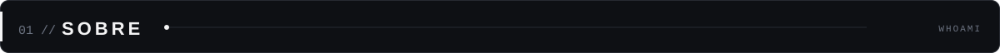
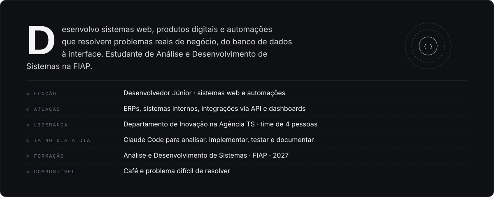

  

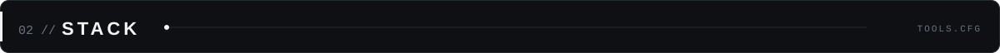

<table align="center">
<tr>
<td align="center" width="96"> React</td>
<td align="center" width="96"> Next.js</td>
<td align="center" width="96"> TypeScript</td>
<td align="center" width="96"> JavaScript</td>
<td align="center" width="96"> Tailwind</td>
<td align="center" width="96"> Node.js</td>
</tr>
<tr>
<td align="center" width="96"> Python</td>
<td align="center" width="96"> PostgreSQL</td>
<td align="center" width="96"> Supabase</td>
<td align="center" width="96"> Git</td>
<td align="center" width="96"> GitHub</td>
<td align="center" width="96"> Vercel</td>
</tr>
</table>

<b>Automação e dados:</b> n8n, Make e Looker Studio

 

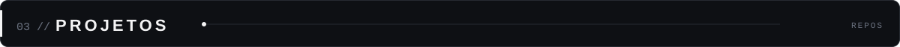
<a href="https://github.com/Nando1N/moukey">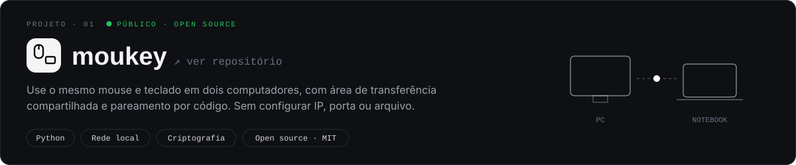</a>
<a href="https://pockey.com.br">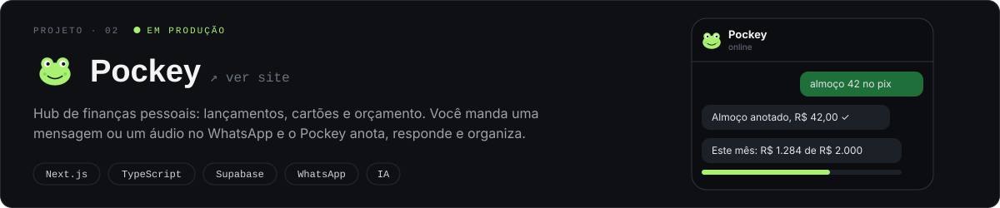</a>
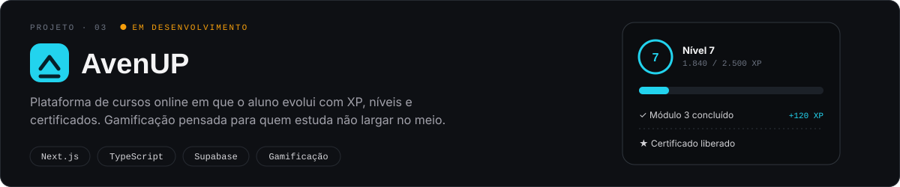
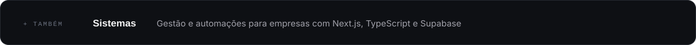

  

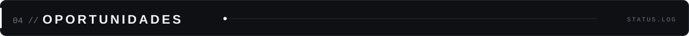
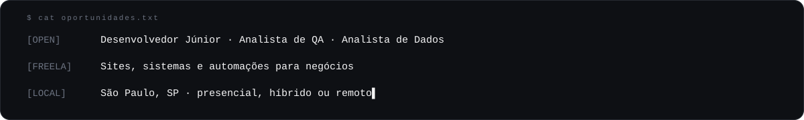

  

